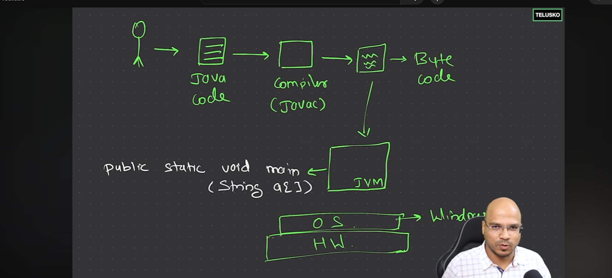

java 17 -> it is LTS (long term support)

- in java you can also do inline coding using **java shell (jshell)** at termainal
- - type 'jshell'
- - now you can using any 'method' , let i want to use 'print' build in fn
- - System.out.print(5)

## How java code/java application works

- in our computer we will be having something which is called JVM(java virtual machine) any os no matter (that why java is called platform/os independent);
- what is platform independent means -> you can run java code on any machine/os irespective of hardware or os

- and due to jvm java code runs
- but jvm itself is platform dependent -> we can't have jvm on ios
- jvm doesn't understand java code direclty it understand byte code so we need to compiler java code to bytes which is what java compiler does (get byte code in .class file after compiling)

- JVM runs a file first and that files must be connected with others if you have a application of multiple files; so jvm runs file by file
- and we only need to mention or give that first file to JVM which file need to have 'main' method
- so make sure we define main method and this method has particular signature -> public static void main
- and main method take arguments -> (String a[])

- so code will not work without this signature

- so one ce you have written you java code you have to compile using 'javac file-name' a .class file will get created
- after that file is compiled run jvm using -> `java file-name`

* think you have to cook food why you prefer cooking food at kitchen bz there is all useful ingrediants which are useful to cook that

* lly jvm need an env where it runs where all imp libraries which help it are available -> which is called -> JRE (java runtime envirment)

* so jdk -> jre -> jvm (where jvm is responsive for java code understanding)

* once you install a jdk you get a updated jre and jvm accordingly with it

## variable

- java is **strongly typed language**

- System.out.println(3+7) you can do any math operatin inside it ; 'ln' -> print in new line

* note **=** this is called assignment operator ; it will take the value from right hand side and assign the value to left hand side

## there are two kinds of data types

1. perimitiv

- basic data types (Integer, float, char, boolean)

2. non-perimitive

## there are two kind of float values

1. float -> 4 bytes; so in case of float var in java , we have to explicitly tell at end that is float (this is not same of double type ; eg float num= 6.6f; but double num= 6.666;)
2. double -> 8 bytes ; java take it as by default ;; bz it take high presition value (digits after decimal place) ;

## char -> 2 bytes (generally in other lang it take 1 byte only bz java support diff language char not only ascii(english) or ot supports unicode )

- follows unicode

* for char we need to use single codes '' (double codes are for string)
* remember it only supports only one char

## boolean -> 1 bytes;; note in other lang boolean may mean 0 and 1 but in java boolean mean only true and false

## now what kinds of values these variable can have --> now we are taking about "literals"

- first int
- - what if we take binary number (base 2) ; eg int num1= 0b101; or hexa decimal number eg int num1= 0x7E;

* - we can put '\_' to represent big number more understable -> int num = 10_00_000;

* Char (imppppppppppppppppppppppppppp)
* - you can increment the value by just do ++ eg char c= 'a'; so c++ will be 'b' ;;
* - int in single code is
